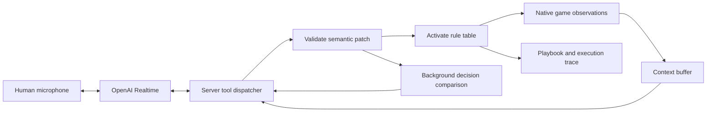

# Pudge Wars: a teammate you can coach

This local demonstration pairs a human in the existing 3D WASM game with **Loom**, a deterministic agent whose movement and hook decisions are controlled by an executable semantic playbook. OpenAI Realtime interprets spoken coaching using the agent's visible gameplay context and proposes typed policy edits. A compiled revision takes effect at the next policy decision.

The current representation work is [policies as semantic reasoning in text](policies/README.md): a seven-layer authoring format, an extraction of Loom's existing policy, and a proposed exchange-based policy. Those Markdown artifacts are independent of running the voice demonstration.

## Run

From the repository root, with the repository's Nim toolchain, Emscripten, Python 3.10+, and sibling `polyworld_data` assets available:

```sh
./scripts/coach_demo.sh
```

Open **http://127.0.0.1:8787**, click **Start 2v2 match**, then **Connect voice**. Focus the arena to use the game's movement and ability controls. You control the human seat; the two opponents use the existing Python rusher policy.

Voice needs `OPENAI_API_KEY` already set in the launching shell's environment. No credential goes into frontend code. The default model is `gpt-realtime-2.1`; `OPENAI_REALTIME_MODEL` can select another compatible Realtime model. Stop and relaunch the server after changing its environment. Without a key, the actual game and typed coaching still run.

For Softmax, use the Secrets Manager setup documented in the sibling `metta` repository:

```sh
./scripts/coach_demo.sh --softmax-key --port 8788
```

This reads `openai/agent-api-key` from `us-east-1` using the `softmax` AWS profile and passes it only in the server environment. The value is neither printed nor written to a file. If the AWS login expires, run `aws sso login --profile softmax` first. `COACH_AWS_PROFILE` can select another authorized profile. Put `--softmax-key` before server options.

On September 9, 2026, this credential authenticated and could retrieve `gpt-realtime-2.1` model metadata, but live Realtime creation returned `credit_balance_exhausted`. Restore the key's OpenAI account credits before testing speech. Model visibility alone does not establish available inference quota.

The launcher builds the native authoritative host and matching WASM client, packages the required terrain assets, installs `aiohttp` in `tmp/coaching/venv`, and serves the demo on loopback. Use `--port 8788` if the default port is occupied. `--autopilot` is for headless checks: it replaces the human seat with a policy and should be omitted when playing.

## First demonstration

1. Move beside the river. Inspect the playbook: Loom normally hooks the nearest eligible enemy, with low-health retreat and urgent teammate rescues taking priority.
2. Say **“When I catch someone, follow up before picking your own target.”** The voice model retrieves gameplay context and adds a `follow_up` rule. A typed shortcut, **“follow up on my hooks,”** exercises the same compiler and runtime without a model.
3. Inspect the new revision, rule and before/after decision comparison. The comparison uses the same recorded observation. If there was no eligible catch in that observation, an unchanged action is the correct result.
4. Catch an enemy while Loom has an available hook and a clear throwing lane. The decision panel identifies `follow_up` when it selects that tactic. Cooldown, range or a teammate blocking the throw can prevent the action. A selected hook can still miss.
5. Say **“Hold your hook while mine is flying.”** This adds a separate conditional wait. An empty teammate hook in flight holds Loom's hook; a catch or the end of that flight releases the wait. Retreat and urgent rescues remain earlier rules.
6. Select a visible enemy in the panel and say **“Focus him.”** That entity reference lasts at most eight seconds. For a durable lesson, use a relation such as **“Prioritize my catches from now on.”** General lessons are saved across matches and server restarts. **Undo last lesson** restores both the live and remembered strategy.

Other typed shortcuts are `retreat below 50 percent`, `hold here`, `follow me`, `stop waiting`, and `stop following up`. Typed input intentionally uses a limited grammar; voice can map natural phrasing to the registered capabilities. Unsupported or ambiguous instructions must not silently become guessed policy changes. The demo's `hold here` shortcut uses Loom's observed position, constrained to its home bank; cursor/world-point grounding is future work.

## Revise a belief and regenerate a policy

The **How Loom understands the game** panel holds a working semantic model above the executable playbook. It contains grounded concepts, two beliefs, goals, strategy links and source evidence. Updating that model does not silently change the active agent.

1. Start a match. Under **Value of teammate catches**, select high confidence and explain why coordinated catches matter. Click **Revise belief**.
2. Click **Generate example policy**. This runs the offline reference synthesizer and independent behavioral checks. Inspect the complete candidate, before/after synthetic scenario and protected-behavior checks.
3. Click **Try this policy**. The checked artifact activates on the next decision. Its provenance links back to the exact working model and generation request. The trial lasts for the current match; existing **Undo last lesson** restores the previous policy.
4. Try a low-confidence catch belief to remove that preference, or revise **Risk of low-health exposure** to explore retreat timing. Confidence is a human assessment, not a learned posterior. The 0.4/0.6 synthesis bands are an explicit demonstration convention.
5. Say or type **“good job, keep going”** to record encouragement without automatic credit assignment. Use **Give feedback or challenge the framing** to attribute praise/criticism, or preserve a new conceptual distinction and its predicted behavior. Unmapped ontology proposals are visibly marked **needs grounding**.

With funded OpenAI access, Realtime can use `record_reasoning` and `submit_policy_candidate` to propose a complete realization of a revised belief. An external coding agent can submit full policy IR through `/api/reasoning` using the local session token and `operation: submit_policy_candidate`. The generation request supplies the pinned semantic model, policy ancestor, editable scope and synthesis instructions. This path accepts multiple realizations; it does not execute arbitrary generated Python or Nim.

The offline generator is intentionally distinguished from model generation. To run its controlled intervention demonstration:

```sh
tmp/coaching/venv/bin/python -m coaching.evaluate_reasoning
```

The report is `tmp/coaching/belief-intervention.json`. Eight reference candidates passed the behavioral contracts in the implementation check. That verifies the pipeline, not the research hypothesis. Working models, source feedback, immutable model snapshots and full generation artifacts are saved under `tmp/coaching/reasoning/<port>/`. Working hypotheses survive restarts; generation requests require fresh match/policy context after restart. **Export model and evidence as JSON** produces an artifact suitable for Git review.

The [revised semantic design](../docs/semantic-coaching-ir.md#what-changes-with-the-meeting-notes) explains the two learning loops and the comparisons needed to test semantic mediation and ontology revision.

## What the IR means

The execution artifact is a **typed executable strategy**, with a versioned set of predicates, selectors and action primitives. The separate working semantic model carries concepts, uncertain beliefs, goals, rationale and strategic implications. A generator realizes supported implications as a full policy artifact; explicit contracts and behavioral checks connect those layers.

For the implemented subset:

```text
compile(policy_document) -> validated immutable rule table
decide(rule_table, visible_observation, memory) -> action, next_memory, trace
render(rule_table) -> readable playbook
```

Compilation currently lowers the document into an interpreted rule table; it does not generate arbitrary code or train model weights. There is one runtime backend, connected to the native engine through its JSON policy protocol.

```json
{
  "id": "follow_up",
  "channel": "hook",
  "priority": 30,
  "when": "coach_catch",
  "select": "coach_catch",
  "intent": "hook",
  "scope": "persistent",
  "goal": "convert_team_catches"
}
```

`goal` explains the purpose of this rule. It is not an optimization command. `when`, `select`, `intent` and `priority` determine its runtime effect. The teammate role resolves within the current match; the persistent rule never stores a particular enemy ID.

The v1 execution contract is explicit:

- Evaluate movement and hook channels independently, in ascending numeric priority. The first feasible rule in each channel wins. Priority ties are invalid. A blocked hook rule falls through; no matching hook rule means no new hook request.
- Facts use only the policy seat's fog-filtered observation. Nearest selection breaks distance ties by entity ID. Catch and rescue relations join observed hook owner/victim IDs to visible players.
- A hook primitive aims at the target's current position, within a conservative 55-tile envelope. It requires hook availability, no existing own hook, and a clear straight corridor around friendly players. It does not predict motion or guarantee a hit.
- Movement primitives go home, occupy a lane beside the teammate, or hold a point constrained to the home bank. The engine still performs movement, collision and action validation. The demo does not explicitly control purchases, melee or blink; engine defaults still apply.
- Temporary focus expires by game tick and becomes ineligible while its target is dead, shielded or invisible. Waiting derives from observed hook flight rather than an unbounded language-model commitment. The memory record stores recent selected rules; it is not a learned hidden state.
- Revisions, schema validation, duplicate-call receipts, bounded entity bindings, scoped edits and undo govern changes. Match-only edits disappear on rematch. Remembering one lesson does not also save unrelated match edits.

The playbook and traces are faithful to this rule evaluator. They are **not yet a faithful representation of the existing champion policy**. Merely putting opaque champion behavior behind an `aim_well` primitive would relocate that opacity. Extracting the strong policy requires an inventory of its decisions, contracts for retained primitives, and action/intent agreement on held-out observations. Any uncovered mechanics must remain visibly outside the claim.

“Doesn't disturb anything else” should mean a declared edit scope and tested behavioral non-interference, not an impossible promise that future game trajectories stay identical. A changed hook can change every later observation. The scenario suite checks immediate movement preservation and unchanged decisions when the catch rule does not apply; full rollout effects require separate experiments.

## Realtime and asynchronous work

The documented default is [GPT-Realtime-2.1](https://developers.openai.com/api/docs/models/gpt-realtime-2.1), an update to GPT-Realtime-2 with improved interruption handling and conversational reasoning/tool use. Browser media uses [WebRTC](https://developers.openai.com/api/docs/guides/realtime-webrtc). The server creates the call using multipart SDP and session configuration, then attaches a [sideband WebSocket](https://developers.openai.com/api/docs/guides/realtime-server-controls) using the returned call ID.



Immediate policy tools are `get_game_context`, `patch_policy`, `get_job`, and `rollback_policy`. The reasoning path adds `record_reasoning`, `submit_policy_candidate` and `try_reasoning_candidate`. The sideband reader launches each tool as an independent asynchronous task. Generation checks run off the event loop and recheck their parents after completion. Unlike the informational background comparison for direct patches, a synthesized candidate must pass its behavioral contracts before it can be offered for trial.

Speech onset anchors the latest available authoritative observation and selected target. The anchor is associated with the model response so a later interruption cannot silently change the context of an older tool request. The buffer contains approximately 15 seconds at 32 Hz. This is an approximation to speech time: capture-clock synchronization, displayed-frame alignment and word-level reference timing are not implemented. A fresh target and revision are checked before staging an edit, and action guards are evaluated again at the actual decision.

## Evidence and remaining work

Run the focused checks after the launcher has created its environment:

```sh
tmp/coaching/venv/bin/python -m unittest discover -s tests -p 'test_coaching*.py' -v
nim r --hints:off --warnings:off tests/test_pw_coworld_proto.nim
```

The 45 Python tests cover policy behavior, scoped edits, semantic history, feedback attribution, multiple realizations, belief interventions, protected behavior, explicit trial activation, stale/asynchronous generation rejection, opponent dependency loading and state isolation, Realtime transport and quota errors. The native protocol suite checks action acceptance and observation semantics. The actual 3D client was tested in local Chromium. The latest live OpenAI test authenticated with the Softmax key but could not proceed to speech because of `credit_balance_exhausted`.

The [hands-on verification report](../docs/coaching-verification-2026-09-09.md) records an opponent-loading failure and its fix, 12 browser workflow checks, two live matches and a controlled native intervention. At 40% health, the regenerated policy physically retreated where the original policy continued following its teammate. The ordinary matches did not isolate that intervention, and stronger play remains untested.

Each run saves policy revisions, coaching events, background reports and sampled decisions under `tmp/coaching/<match-id>/`. A completed native match also saves its action replay and results. Interrupting a match with **New match** or stopping the server does not finalize the native replay. Remembered strategy lives in `tmp/coaching/remembered-policy.json`. These are local artifacts, not uploads. Raw microphone audio is not archived by this demo; it is sent to OpenAI during a connected session.

The host's action acceptance echoes have no request IDs. The UI therefore reports engine acceptance separately from rule selection; it does not claim exact receipt-to-rule attribution under network delay. Decision logs sample every eight ticks, so they are inspection artifacts rather than a complete policy-reproduction dataset.

The live application's background checks compare the parent and candidate on recorded observations. They report changed decisions, not counterfactual game outcomes or stronger play. Autonomous model generation and research-driven activation in the live application remain unimplemented.

A separate [text/symbolic policy experiment](symbolic/README.md) now implements code generation, code-derived extraction, paired native rollout evaluation and a bounded parameter optimizer with a held-out retention gate. Its [first measured run](../docs/semantic-policy-roundtrip.md) produced a competitive generated support policy and exact round trips; the automatic aiming adjustment failed to improve held-out performance, so the loop retained its parent. This grammar and skill library are a separate executable projection of the seven-layer text proposal. Integrating them with human coaching contracts and testing durable learning against matched controls remains further work.

The broader [experiment plan](../docs/human-coachable-pudge-wars.md) distinguishes coaching from human gameplay data, co-play from observer coaching, and immediate coordination from durable learning. The [semantic model design](../docs/semantic-coaching-ir.md) describes how to extend the executable subset to beliefs, temporal commitments and transferable strategic artifacts.
