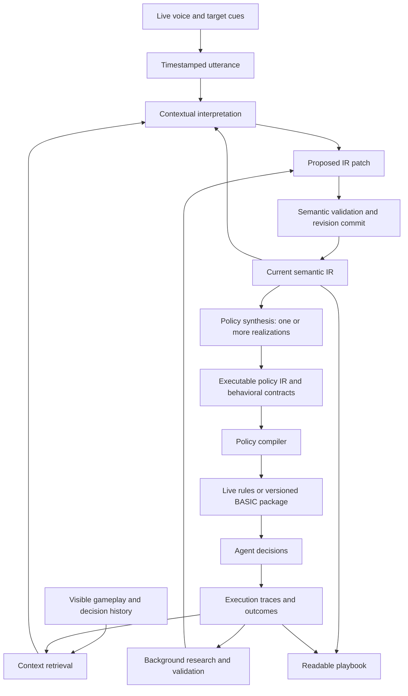

# Semantic reasoning IR and live voice coaching

**Current direction:** focus on [textual policy ontologies](../coaching/policies/README.md). The seven-layer representation adds explicit skill contracts, intentions and update rules. It includes an extraction of the existing policy and a separate proposed exchange ontology. This document retains the earlier runtime architecture and experiment context.

Architecture and implementation direction, September 9, 2026. Companion to the [build and experiment plan](human-coachable-pudge-wars.md). The [demonstration](../coaching/README.md) now separates a working semantic model from executable policy IR. It includes grounded concepts, two editable beliefs, goal/strategy links, contextual feedback, ontology proposals, complete policy-candidate submission, independent behavioral checks and explicit live trials. General ontology induction, arbitrary-code synthesis, BASIC lowering and autonomous research promotion remain proposed. The latest live OpenAI check was blocked by `credit_balance_exhausted`; the offline demonstration requires no model calls.

## The central contract

The human speaks while playing. The system retrieves the gameplay they mean and distinguishes a tactical command, a belief revision, feedback, and a challenge to the current framing. A belief revision changes a working semantic model. A generator then proposes a complete policy realization, which must pass compilation and behavioral checks before a live trial. The human can inspect the semantic change, generated behavior, and execution separately.



Every strategy realization passes through executable IR. Immediate commands can still modify that IR directly; broader belief changes use the synthesis path. The spoken response reports interpretation or execution status; it cannot itself commit a policy update. The semantic model records explicit task reasoning and its evidence, not a transcript of a model's private reasoning process.

## What changes with the meeting notes

The central hypothesis is **semantic mediation fidelity**: a useful representation of a human's intent makes regenerated policies more likely to implement the intended behavior. Adding an intermediate representation does not establish that hypothesis by itself; it introduces another representation that must be tested.

Keep two artifacts:

- **Working semantic model:** concepts, beliefs, goals, strategic implications, rationale, sources, and unresolved frame challenges. Its assertions can be uncertain or wrong.
- **Executable policy realization:** a complete, versioned program in the supported policy IR, with primitive contracts and actual execution traces. Its behavior can be faithful to a belief that turns out to be mistaken.

Generation is allowed to be stochastic and many-to-many. The requirement is that each realization satisfies declared behavioral contracts and preserves protected behavior. Exact reproducibility attaches to the saved policy artifact, runtime version, inputs and state; it does not require the coding model to emit the same source text again. Archive the semantic snapshot, parent policy, generator identity/configuration, complete output and evaluation report for every attempt, including failures. The current demo records these fields except detailed provider sampling metadata, which must be added before a model-generation experiment.

```text
working model + current policy commitments + capability contracts
  -> generator proposes a complete policy artifact
  -> schema/compiler checks + independent behavioral checks
  -> human inspects proposed realization
  -> live trial at a decision boundary
  -> observed outcomes and attributed feedback
  -> belief revision or a proposed change to the ontology
```

The current implementation supports full policy-IR submissions through `submit_policy_candidate`. Realtime can generate them after `record_reasoning` returns a pinned generation request. An external coding agent can use the same local API. **Generate example policy** uses a clearly labeled offline reference synthesizer, allowing the entire review/activation path to be exercised without OpenAI credits. This reference mapping is not evidence that a coding model understands nuanced beliefs.

### Earlier runtime subset and the seven-layer text representation

The earlier notes enumerated five layers, which informed the small runtime model below. The subsequent seven-layer framing is now the basis of the [text representation](../coaching/policies/README.md): situation, belief, goal, skill, strategy, execution and update. Ontology and evidence connect all seven; intentions connect skill selection to execution. The table below describes the implemented subset rather than the full target representation.

| Layer | Current representation | Execution boundary |
|---|---|---|
| Situation | Fog-filtered observation and a timestamped context/decision snapshot | Observations are facts about the available view, not access to hidden state. |
| Belief | Claim, concept references, human-assessed confidence, rationale and source-event IDs | Confidence is not a calibrated posterior. Registered synthesis contracts define supported interventions. |
| Goal | Named team advantage and survival objectives | A goal needs a linked strategic implication; arbitrary prose does not specify a policy. |
| Strategy | Belief → goal → behavioral consequence | Multiple complete policies can realize one implication within the protected scope. |
| Execution | Typed movement/hook rules and versioned primitives | Actual decisions and attempted actions are traced here. |

Ontology supplies the meanings and grounding of concepts used across these layers. Evidence connects claims and realizations to human remarks, observations, tests and outcomes. The current model is small: `catch_value` and `punishment_risk` are explicit working hypotheses, not learned opponent models. A broader claim about opponent tendencies will need identifiable opponents, observation windows, calibrated estimators and a retention policy.

### Learning inside an ontology and revising the ontology

Use two loops with separate evidence standards:

1. **Within-model loop:** update an estimate or belief while its concepts and measurements remain fixed. Bayesian updates are appropriate when the prior, likelihood, evidence and conditioning population are specified.
2. **Model-revision loop:** propose new distinctions, temporal abstractions or causal relationships when the current representation systematically misses relevant patterns. Require grounding, examples, counterexamples and a comparison against the current model before using the new concept in policy synthesis.

Bayesian methods can represent uncertainty over model structure and support model discovery; they do not inherently require one immutable ontology. Choosing and expanding the space of models remains a substantive design problem. See [Ghahramani's review](https://www.repository.cam.ac.uk/bitstream/1810/248538/1/Ghahramani%202015%20Nature.pdf).

We will call this an **ontology–policy revision loop**. Identifying it with the Free Energy Principle would require a specified generative model and the relevant variational objective; an iterative feedback loop alone is insufficient. See [Friston and colleagues' formal account](https://arxiv.org/abs/2201.06387). The hemisphere framing is a metaphor for executing within a frame versus questioning it, not a neurological model of the software or a validated account of LLM failures.

In this version, “think of the game as a continuous unit” becomes a preserved ontology proposal with an optional testable prediction, such as “after a missed hook, reposition for the next exchange.” It remains `needs_grounding`. A later coding task must define an exchange state, observation boundaries, expiry/reset behavior and scenario contracts. The system must not silently approximate the remark as “increase retreat threshold.”

Continuous timing makes Pudge Wars a useful test of temporal context and perceptual uncertainty. We do not assume that discreteness makes other games easy, or that explicit opponent beliefs are necessary to achieve good performance here; compare against policies without them.

### How a human remark propagates

| Remark | Immediate record | Conditions for policy change |
|---|---|---|
| “Good job, keep going.” | Unassigned encouragement linked to context | No automatic probability update, reward assignment or policy edit. |
| “That catch follow-up was good.” | Praise explicitly attributed to a rule or belief | Evidence for human preference; not proof that the tactic caused a win. |
| “They punish us when we're hurt; I'm confident we should retreat earlier.” | Revised exposure-risk belief, rationale and source | Generate a policy candidate; test the threshold direction and preserved behavior; inspect before trial. |
| “Think of the game as a continuous unit.” | Ontology proposal and requested observable prediction | Add and validate a temporal concept before claiming it is executable. |
| “Your explanation fits the rule, but that rule misses what's happening.” | Criticism plus a possible frame challenge | Diagnose interpretation, synthesis, belief truth, missing state or ontology failure separately. |

Model snapshots and feedback are stored under `tmp/coaching/reasoning/<port>/`; each change links parent and resulting hashes. Complete generation inputs and outputs are separate files. JSON export supports Git review. The application does not commit the user's repository, publish observations, or silently overwrite older policy realizations. Generation jobs from an older model, policy or match cannot be activated; corrections also invalidate results that finish asynchronously.

### The next discriminating experiment

First freeze a corpus of coaching cases with independently specified expected behavior and negative controls. For each case, vary one belief while keeping the situation, primitive library, other beliefs/goals, policy ancestor, generator configuration and budget fixed. Generate multiple complete realizations per condition. Hold back evaluation situations from the generator.

Measure intended directional change, preservation outside the edit scope, invalid-generation rate, human prediction of behavior and uncertainty across independent generation runs. Compare full semantic context against direct prose-to-policy and an ablation with rationale/evidence removed. Do not score a rationale by how persuasive it sounds.

Next compare a frozen ontology against a workflow allowed to propose and validate new concepts. Account separately for additional features, human time, coding effort and generation budget. Use systematic prediction errors and human-identified counterexamples to choose revisions; one loss cannot distinguish a bad ontology from a bad estimate or stochastic game outcome.

Finally evaluate selected policies in uncoached, held-out 2v2 matches with frozen partners/opponents and paired seeds. The eight-candidate offline demonstration tests implementation contracts by construction. It cannot establish semantic mediation fidelity, opponent-belief accuracy, better win rate or a Free Energy Principle explanation.

## What the semantic layer represents

The representation has two lifetimes: a transient situation model and durable strategic knowledge. Keep their versions and provenance connected, but do not retain a particular enemy ID as a general lesson.

| Node type | Example | Meaning and execution |
|---|---|---|
| Observation | “My teammate's hook caught enemy 4 at tick 1290.” | Authoritative visible event with source and observation time. Expires or is retained as historical evidence. |
| Belief | “That opponent may be baiting us into the river.” | An uncertain interpretation with evidence and expiry. Not promoted to an observed fact. No arbitrary belief string can drive an action. |
| Goal | “Convert our catches into team kills.” | Human-readable objective with declared priority. Operational behavior requires linked tactics; the compiler cannot guess what optimizing the goal means. |
| Constraint | “Do not pursue an enemy across the river.” | A defined restriction on specified decision channels and scope. Requires a capability mapping covering the actions it claims to constrain. |
| Tactic | “When my teammate catches someone, use my next eligible offensive hook on that enemy.” | Typed condition, target selector, intent, priority, exceptions, and termination; compiles into policy. |
| Commitment | “Hold my hook while the teammate's current throw is in flight, then release if it misses.” | Explicit temporal state with start, completion, cancellation, and maximum duration. |
| Hypothesis | “Following up on catches will outperform independent poking.” | A testable claim linked to scenarios and evaluation results; remains a hypothesis until evidence supports it. |
| Feedback/example | “At this moment I wanted you to save the hook.” | Grounded human judgment that proposes a rule or scenario, with the relevant observation window. |

A runtime belief estimate needs registered input features, an estimator and a typed output consumed by a rule. A strategic belief can instead influence a generated policy through an explicit synthesis contract, as the current demonstration does. These are different mechanisms. Broader beliefs can be stored for research while the agent executes only supported predicates and primitives.

Goals and hypotheses explain why a rule was proposed; execution traces explain why a particular action happened. Those are different evidence sources and should be labeled in the UI.

### When can we say it represents a policy?

A policy representation must specify enough to determine the next action distribution and the next internal state from the available observation and current internal state. In a deterministic implementation, that reduces to:

```text
(observation, policy_state) -> (action, next_policy_state)
```

The artifact therefore needs the vocabulary and feature definitions, any state update or estimator, decision composition and arbitration, action primitives and their contracts, and the scheduling/randomness conventions. A prose objective plus a list of preferred behaviors leaves this function underspecified. A goal becomes executable only when it is explicitly lowered to a rule, constraint, scoring function or planner objective with defined semantics.

The demo's ordered rule table is one useful executable subset. It should not become a requirement that every future policy fit a flat decision list. Inspect the strong policy to discover which additional constructs are necessary: target scoring, reusable subpolicies, bounded temporal options, probabilistic decisions, or belief-state updates. Add each construct with a readable rendering, a runtime meaning, an editable scope, and independently specified scenarios. A generic `run_champion_policy` escape hatch is an explicitly opaque component, not successful semantic extraction.

There are three separate fidelity questions: does the interpreter implement the IR's semantics; does the readable view convey those semantics well enough for humans to predict strategic decisions; and does an extracted IR reproduce the source policy on relevant held-out situations? The first demo addresses the first two for its small policy. It has not established the third. State-action agreement on sampled observations is useful evidence, but does not prove equivalence on unseen trajectories.

Transfer should initially mean exporting a tactic together with its required observations, primitive contracts, examples, and evidence. A destination controller must map those requirements and pass the behavioral contracts before the rule is considered compatible. Competitive benefit is then a separate evaluation. Shared English labels such as “rescue” do not establish compatible mechanics across games.

## A spoken lesson and its IR

While an enemy is caught on the human's hook, the human says:

> “When I catch someone, follow up before you pick your own target. Do that from now on.”

The context resolver identifies the speaker's seat, current catch, recent agent shot, and existing target priorities. The interpretation is a persistent priority change. It does not automatically imply “wait indefinitely for me to throw” or “never defend yourself.”

An illustrative IR fragment follows. Identifiers, predicates, and intents belong to a versioned capability registry; this is a schema proposal, not existing code.

```yaml
schema_version: 1
revision: 18
parent_revision: 17
goal:
  id: convert_team_catches
  statement: Follow up on my teammate's catches
rule:
  id: follow_up_on_coach_catch
  actor: coached_agent
  scope: persistent
  when:
    relation: visible_enemy_currently_carried_by
    subject: coaching_teammate
  select:
    relation_target: visible_enemy_currently_carried_by
    subject: coaching_teammate
    tie_break: stable_entity_id
  intent: offensive_hook_selected_target
  priority:
    before: [independent_poke]
    after: [immediate_self_defense, urgent_ally_rescue]
  requirements: [target_alive, target_visible, hook_available, friendly_lane_clear]
  active_until: relation_ends
  supports_goal: convert_team_catches
provenance:
  utterance_id: utterance_42
  context_bundle_id: context_93
  interpretation: Prioritize the caught enemy; other shots remain allowed when no catch exists
validation:
  semantic: pending
  compile: pending
  behavioral: untested
  competitive: untested
```

`coaching_teammate` resolves to a session role, not a permanently embedded player ID. The rule's persistence is distinct from the lifetime of each activation. Requirements that fail generate a blocked reason and follow the explicitly defined fallback policy. The reference specification must say whether to wait or use another tactic; it cannot leave this behavior to an LLM at runtime. For this initial rule, a catch with an unavailable/unsafe hook does not reserve movement or override defense; the hook attempt remains pending only while the catch relation exists. Other eligible hook tactics may proceed if the follow-up is infeasible.

The response can be: “I'll prioritize enemies you catch, while keeping defense and urgent rescues first.” The panel shows “Trying this now; long-term validation pending” if the rule qualifies for live activation. If the human says “No, wait for my hook too,” that becomes a separate bounded hold commitment with an explicit timeout and release conditions.

## How gameplay context is obtained

Maintain a rolling buffer on the authoritative host, initially about 15 seconds with a configurable limit. Store per-decision context for the coached agent plus event indexes. Archive the windows used for interpretation and retain full policy-input prefixes or supported checkpoints for the separate shadow evaluator.

Context includes:

- Self and teammate positions, health, cooldowns, visible opponents, flying hooks, current catches, and relevant geometry.
- Recent launches, catches, rescues, kills, damage, pings, and human-issued game actions.
- Agent decision traces: selected rule, attempted/accepted actions, defensive overrides, and active temporal commitments.
- Client cues: hovered/selected entity, cursor world point, viewed region, and displayed tick near the speech interval.
- Current semantic IR, active compiled revision, current conversation turn, and unresolved references from recent turns.

Use a bounded retrieval interface such as `get_context_bundle(match_id, utterance_id, focus, before_ticks, after_ticks)`. Its permissions bind the requester to the coached agent's team and authorized view. It returns referenced facts and traces with stable IDs, not the whole unrestricted world or arbitrary file access. For live interpretation, the requested window is clamped to data already available; later outcome annotations are recorded separately.

The microphone stream records capture times and transcript segment times. The client periodically associates its monotonic clock and displayed game tick with the host clock, including a measure of uncertainty. In a predicting client, the rendered position may differ from authoritative state. Preserve that distinction so the system can understand what the human saw while validating actions against what the host knows.

Resolve “that guy” using explicit selection/ping first, then the recent conversational referent or event context. If several candidates fit, ask briefly—“The one on your hook?”—and leave the dependent patch pending. “Why did you do that?” retrieves the recent relevant decision, rather than assuming the latest frame explains it. Short windows can widen through explicit retrieval when a reference points to an earlier event.

The observation path must apply team visibility even where the native host possesses full state. A remembered enemy position carries its last-seen time and is not treated as current sight. Recheck target existence, visibility, relation, instruction expiry, and current policy revision at activation. Interpretation uses the historical moment; execution uses fresh facts.

## Voice interaction during play

Start with a microphone/conversation panel embedded in the browser game shell and a separate voice service connected to the native host. Provide hold-to-talk and an explicit open-microphone conversation mode, both with a visible listening/mute state. The policy runner remains local to the host; voice transport and model work do not execute inside the simulation tick.

Use OpenAI Realtime directly, as requested. The current implementation defaults to `gpt-realtime-2.1`, using browser WebRTC media and a server sideband WebSocket for context retrieval, semantic patches and background-job tools. Long work is dispatched asynchronously and returns a job ID. The microphone has connect, mute and disconnect controls; push-to-talk remains a future option. See the [implementation and official API references](../coaching/README.md#realtime-and-asynchronous-work).

Partial transcripts may trigger context prefetch and a provisional interpretation, but cannot commit executable edits. Finalized clauses create versioned proposals. This prevents “chase him—actually, don't chase him” from making the first partial phrase an action. New speech interrupts spoken playback; an explicit cancellation invalidates pending proposals. An action already accepted by the game cannot be undone, so acknowledge when cancellation came too late.

Classify turns as instructions, corrections, questions, preferences, examples, or encouragement. A question can produce an explanation without a policy patch. A spoken correction invalidates or revises the relevant prior proposal, not every active rule. Deduplicate transcript retries by utterance ID and revision. Preserve negation and human corrections in the grounding evaluation corpus.

Brief acknowledgments should name the behavior: “Following up on your catches.” More detail is available in the playbook or on request. Keep speaking optional so replies do not overwhelm combat audio. Reconnect resumes the conversation and shows the actual active policy revision; it does not resend old instructions as new ones.

Provisional engineering goals: display microphone/input status immediately, return a short interpretation acknowledgment within about one second of a completed short utterance, and activate a supported patch within about two seconds. Measure p50/p95 on the actual stack and revise the targets after the first spike. Applying an already validated patch takes the next eligible decision boundary; the underlying game ticks every 31.25 ms, but decision cadence, cooldowns, and network/model latency affect when behavior appears. Voice is for tactical and strategic coordination; direct pings remain useful for urgent target selection.

## Lowering semantics into policy

Use three explicit stages:

1. **Semantic IR:** typed relations, goals, tactics, constraints, commitments, scope, provenance, and validation state.
2. **Policy IR:** a small executable form with registered predicates, deterministic selectors, ordered arbitration per decision channel, intents, typed parameters, and bounded temporal state.
3. **Runtime artifact:** a host-evaluated rule table for live changes, or a generated BASIC package for changes requiring a new program.

The first vocabulary supports focus target, follow up on a teammate catch, hold a position/region, retreat threshold, and rescue priority. A tactical hold uses explicit phases such as idle → waiting for teammate hook → following up/released, plus a maximum duration. Constants specify units and compile into integer ticks, coordinates, or fixed-point thresholds. Priority cycles, unresolved roles, unsupported predicates, unbounded waits, and incompatible capabilities fail compilation with a human-readable reason.

Do not compile arbitrary prose through an unconstrained text-to-code prompt. A proposal outside the vocabulary can request a new capability for the background development workflow, but it cannot silently activate an approximation.

The implemented Python evaluator consumes the complete policy IR through the JSON host protocol. A future BASIC backend can expose those decisions at named strategy gates while retaining mechanical routines under explicit contracts. Define arbitration for hook, movement, defense, and other channels explicitly; one instruction must not accidentally suppress purchases or rescue logic. Constraints such as “never pursue across the river” need coverage of all relevant movement and blink paths before that full claim is supported.

Preserve `semantic_rule_id` through lowering and record the compiled revision in each decision trace. An independent reference evaluator over the supported IR and golden observation histories should agree with each runtime backend on selected rules, targets, and intents. Source maps and aligned compiler tests substantiate the readable playbook's faithfulness.

## Transactional policy updates and durable learning

Track proposed IR, committed IR, and the IR revision actually running. A valid semantic revision may remain inactive if lowering fails or activation is deferred. Show this status explicitly; “I learned it” is inappropriate while the controller still runs the old revision.

Each patch carries an ID, parent IR revision, utterance revision, match/agent identity, intended scope, and expiry. Semantic validation checks references, intent scope, priority/constraint consistency, and available capabilities. Compilation and fast behavior checks produce a candidate artifact. The host checks the current parent and fresh context, then atomically swaps the active rule table at a decision boundary and returns the effective tick. Cancel or supersede stale proposals; do not apply a slow reply to a later match.

A live table change preserves BASIC globals. Unchanged temporal rules retain their state; changed or removed rules reset their rule-local state under the declared update contract. Log this reset. Full program replacements activate between matches with a deliberate memory reset unless an explicit migration is supported. This keeps an immediate policy update possible without pretending arbitrary BASIC replacement is safe during play.

Explicitly temporary commands expire. Explicitly durable instructions create a persistent candidate and may run as a reversible live trial if the supported vocabulary and fast checks allow it. The research worker subsequently checks behavior contracts and broader performance. Session preferences do not silently become permanent lessons, and a few successful live actions do not establish competitive improvement.

Autoresearch reads the semantic IR, coaching evidence, and outcomes; proposes scoped IR revisions; lowers them through the same compiler; evaluates them; and attaches the result to the corresponding revision. It cannot overwrite human commitments or change their meaning to improve its score. A rejected candidate preserves the previous active version and its evidence. A worker result based on an old parent requires revalidation before promotion.

## Implementation slices and evidence

The implemented boundaries are `coaching/reasoning.py` (working model, feedback, complete generation requests and behavioral contracts), `coaching/policy.py` (executable schema, lowering, evaluator and playbook), `coaching/server.py` (match/context orchestration, asynchronous generation checks and trials), `coaching/realtime.py` (OpenAI voice and model tools), and `coaching/web/` (game and coaching UI). `coaching/evaluate_reasoning.py` produces the offline intervention report. The table below describes possible later decomposition. Working semantics and executable policy IR now have separate representations and versions.

| Component | Proposed location/responsibility |
|---|---|
| Voice/game panel | `examples/pudge_wars/coach-panel.js` plus game shell integration; capture, transcript, brief responses, corrections, active revision |
| Authoritative coaching handler | `examples/pudge_wars/coaching.nim`; session authorization, revisions, effective ticks, expiry, live rule evaluation |
| Context capture and traces | `examples/pudge_wars/coachtrace.nim` and host integration; fog-filtered input windows, event/decision IDs, client cue alignment |
| Semantic IR and validation | `coaching/ir/`; schema, capability registry, scope/priority checks, revision ledger |
| Interpretation and context retrieval | `coaching/interpreter/`; streaming adapter, utterance lifecycle, bounded context retrieval, structured patches |
| Compiler | `coaching/compiler/`; semantic-to-policy lowering, live tables, BASIC templates, source mapping |
| Research worker and evaluation | `coaching/research/`; immutable jobs, contract tests, paired rollouts, promotion evidence |

First implement one instrumented policy rule and a recorded-context/transcript harness. Then connect the browser microphone and live context buffer to that exact path. Ship a complete browser 2v2 demonstration where the human speaks about a catch, the agent updates its semantic tactic, the compiled rule changes the next eligible decision, and the response points to the actual trace. Add persistent research validation immediately afterward.

Acceptance scenarios include: selected versus ambiguous “him”; speech referring to the preceding catch; “don't” arriving in a transcript revision; a target dying during interpretation; a newer correction overtaking an older model response; conversation interruption; temporary versus permanent scope; opponent state outside shared sight; live rule-state reset; a worker completing against an old IR revision; and voice failure while the match continues normally.

Measure reference resolution against human-confirmed labels, instruction interpretation against independently specified contracts, and executed behavior against trace-linked scenarios. Measure transcription, interpretation, patch validation, activation, and first eligible action latency separately. Compare the same recorded utterances with and without gameplay context, then run the coached/uncoached learning comparison from the main plan. All learning arms must share the semantic representation and compiler so the coaching comparison does not accidentally become a comparison of controller architectures.
