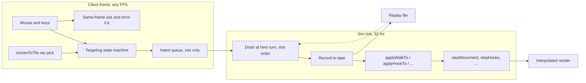

# Human play — research and design

Status: Research complete, implementation staged in tiers

PolyWorld's design doc names two modes of interaction: playing the game and
spectating. Spectating works today. Playing does not exist yet — every command
in every game comes from a BASIC VM or a replay tape. This doc researches what
a first-class human player experience requires in a Warcraft 3 / StarCraft
style game, and designs how Pudge Wars becomes the testbed for it.

The goal is not "add mouse control." The goal is a human seat good enough that
people *choose* to play alongside their agents: as a teammate of five bots, as
an opponent, or swapping between seats mid-match. That makes human play a
research instrument, not just a demo: human evaluation of agents, mixed
human-agent matches, and replays that double as imitation-learning data.

## Where the engine is today

| Capability | State |
|---|---|
| Deterministic 24 Hz sim, action tape, per-tick hashes | Done, tested |
| Camera pan (RMB drag), zoom, RTS fixed-north eye | Done (`graphics.nim`) |
| Transport: pause, speed, scrub, checkpoint rewind | Done (`polyworld/player.nim`) |
| Action grammar: `walkTo`, `hookTo`, `attackTarget`, `buyUpgrade` | Done, replay-recorded (`bots.nim`, `sim.nim`) |
| Mouse-to-world picking | Missing (GOTA has screen-space entity pick only) |
| Hotkeys / ability targeting / command input | Missing |
| Minimap in Pudge Wars | Missing (exists in GOTA/LVD to port) |
| Death, respawn, victory/defeat presentation | Missing |
| Audio, anywhere in the engine | Missing entirely |

The load-bearing fact: bot host procs in `bots.nim` already do
`recorder.recordWalkTo(...)` then `applyWalkTo(...)`. A human controller that
does exactly the same two calls is automatically deterministic, replayable,
seekable, and hash-verified. **A human is a seventh source of the same actions
— a bot made of meat.** Nothing about the sim, tape format, or headless
verification needs to change for Tier 0.

## Research

### 1. Latency: the genre solved this with acknowledgment, not speed

Warcraft 3, StarCraft, and Age of Empires all ran deterministic lockstep where
a command waits for a network turn before executing. The measured tolerances
from the Age of Empires postmortem ("1500 Archers on a 28.8"):

- Command latency under **250 ms is not noticed** in an RTS. 250–500 ms is
  "very playable." Beyond 500 ms it becomes visible.
- **Consistency beats speed.** A steady 500 ms felt better than latency
  oscillating between 80 and 500 ms; players build a mental "game pace."

Patrick Wyatt (StarCraft/WC3 engineer) documents the other half: the games
mask the wait by responding **instantly in presentation** — the unit barks
"Zug zug," the click marker pulses, the animation starts — while the
authoritative effect lands a few turns later. Perceived latency is the gap
between input and *any* response, not input and effect.

What this means for Pudge Wars at 32 Hz (raised from the engine's shared
24 Hz default for exactly this reason), in-process:

| Stage | Cost |
|---|---|
| Input poll (windy, per frame at 60 fps) | ≤ 17 ms |
| Intent queued → next decision tick | ≤ 32 ms, ~16 ms average |
| Applied state → interpolated render (`renderAlpha` lags one tick) | ≤ 32 ms |
| Worst case input → authoritative pixels | ~80 ms |
| Same-frame acknowledgment FX (client-only) | ~0 ms perceived |

~80 ms worst case is a third of the threshold where RTS players start
noticing, and it is *constant* — the property AoE found mattered most.
Commercial MOBA servers run 30 Hz ticks; 32 Hz is the same granularity class.
Conclusion: **no client prediction needed.** This keeps the readme's non-goal
intact ("will never require client-side simulation or prediction"). All
effort goes into same-frame acknowledgment instead.

### 2. The WC3/Dota control grammar is the spec

Twenty-five years of RTS/MOBA muscle memory is a free asset. Deviating from it
costs more than any improvement it buys. The genre grammar:

| Input | Meaning |
|---|---|
| Right click on ground | Smart command: move there |
| Right click on enemy | Smart command: attack it |
| Left click | Select / confirm a targeted cast |
| Q W E R / F | Abilities (Q Meat Hook, E Grapple, F Blink) |
| 1–6 | Items / purchases (here: the four upgrades) |
| A + click | Attack target explicitly |
| S | Stop |
| Space / F1 | Center camera on hero / select hero |
| Edge scroll, arrows, minimap click, MMB drag | Camera |
| Shift | Queue commands (out of scope for v1) |

F8 (or F3 → Record bug tape) writes a shareable `.pwr` to `duels/bug_YYYYMMDD_HHMMSS.pwr`; `duels/bug_latest.txt` points at it for Cursor attach.

Pudge Wars is a **single-hero** game — exactly Dota's control shape, not
StarCraft's. That deletes the expensive parts of RTS input (box select,
control groups, subgroup tabbing, command cards for 12 unit types) and leaves
nine interactions. The design should still keep "which entity do my inputs
drive" as an explicit concept so Light vs Dark can later reuse the layer for
real multi-unit RTS control.

Casting paradigms, from Dota 2's settings (the community's revealed
preference): *normal cast* (Q arms a targeting state, LMB confirms, RMB/Esc
cancels, a range ring shows while armed) versus *quickcast* (cast at cursor
the instant Q is pressed). Hook is the entire game here, so support both from
day one; quickcast is the skill-expression default, normal cast is the
learnability default. Ship normal cast as default, `--quickcast` and an
in-match toggle.

Aim resolution: replay actions carry tile coordinates (128×128). Worst-case
lateral aim error is half a tile, and the base hook latch radius is one tile,
so tile-grain aim is acceptable for v1. If high-level play ever wants sub-tile
aim, that is a replay format bump adding a fixed-point fraction to
`ActionHookTo` — noted, not planned.

Blink (F) is an instant 48-tile hop along the aim ray. It always lands on the
**farthest legal tile** toward the click (walkable on the destination layer,
unoccupied, not a palisade): a cliff or wall truncates to the grass in front
of it instead of eating the order. River water is a legal landing — blink
into the drink to swim, blink out onto a bank to leave. A click on the
enemy bank still hops the river. Fog does not gate the dest. You cannot
blink while hooked (you are the victim being reeled), dying, or winding up a
hook (the head has not left the hand). Once a Meat Hook is in the air —
outbound or still on the rebound/return while the chain is out — blink is
allowed and **adds the hop's actual distance** to that hook's remaining
range. The head keeps its world position and heading; a 48-tile blink buys
about 48 tiles of extra outbound. A zero-length hop adds nothing. Cooldown
still applies.

### 3. Feedback: every input answered the same frame

The single most common failure that makes a game feel broken is the silently
eaten input. The sim already tells us everything we need: every `apply*` proc
returns accept/reject, and rejects are *specific* (dying, in river, cooldown,
hook in flight, no points, max level, unwalkable target). The rule:

> Every input produces same-frame feedback: an **acknowledgment** (the command
> was accepted) or an **error** (why it was not). Nothing is silent.

Acknowledgments, mapped to systems that already exist:

| Event | Feedback | Existing system |
|---|---|---|
| Move accepted | Green ground pulse at target | `shapes.nim` world shapes |
| Attack accepted | Red flash on target | `selectionoutlines.nim` |
| Hook cast | Wind-up + chain already render | `graphics.nim` meat hook renderer |
| Hook armed (targeting) | Range ring + aim line at cursor | `shapes.nim` |
| Command rejected | Icon shake, red flash, one-line reason ("Hook is on cooldown") | `chrome.nim` HUD |
| Damage dealt/taken | Floating damage numbers; brief edge vignette when *you* are hit | `worldbars.nim` / new |
| Kills | Kill feed + announcer line (headshot/deny lines already exist in `ui.nim`) | extend |

**Audio is the biggest gap.** The engine has no audio system at all, and half
of WC3's feel is acknowledgment VO and hit confirms. The readme already
designs the audio boundary (client-only, sim may name a sound by path). Plan:
visual-only acknowledgment for Tiers 0–2 — it works, silent-film style — and a
minimal one-shot audio module as its own milestone (Tier 3), rather than
blocking playability on a new engine subsystem.

### 4. Playing alongside agents is its own design problem

The precedents:

- **OpenAI Five Arena (2019)** ran a cooperative mode — humans teamed with
  bots — for 35,466 games. Testers "reported feeling supported by their bot
  teammates" and that it was fun. The recurring friction: **no communication
  channel** — bots' plans were opaque and humans couldn't signal intent.
- **AlphaStar** drew the fairness lesson: superhuman mechanics (APM, camera,
  reaction time) make mixed play pointless; DeepMind added APM caps and camera
  constraints to keep the comparison meaningful.

Both lessons bite Pudge Wars directly. Bots decide **every tick**: 32 command
windows per second, with perfect lead-aim arithmetic — an equivalent of >1,900
APM and 31 ms reactions. Unthrottled, they are miserable to play against and
pointless to play with. The fixes must live **in the sim and on the tape**
(deterministic, reproducible), never as client-side smoke:

1. **Handicap knobs recorded in the replay setup**: per-slot decision cadence
   (act every N ticks), seeded aim noise applied *before* the action is
   recorded (the tape stores the final, noised coordinates — replays stay
   exact). Presets: easy / fair / pro.
2. **Human → agent signaling**: a `ping(x, y)` action — a sim no-op that is
   recorded on the tape and exposed to BASIC as host data next decision. The
   determinism rule generalizes: *anything an agent can observe must be a
   recorded action.* Bots that respect pings become better teammates; the tape
   shows whether they did.
3. **Agent → human legibility**: surface each bot's BASIC `print` output as a
   chat bubble / roster line ("hooking 4", "saving ally"). Presentation-only,
   live-mode only (replays don't re-run VMs).
4. **Seat fluidity**: any of  6 slots is bot- or human-driven, assigned at
   launch; mid-match take-over the(press a key to grab/release a teammate's seat,
   the VM resumes when released) makes the human seat a *research probe* —
   DAgger-style corrections, "let me show you," instant difficulty adjustment.
5. **Provenance**: replay setup tags each slot's controller (and take-over
   events), so human games are labeled imitation data for free.

## Design principles

1. **Never silent.** Every input gets same-frame acknowledgment or a specific
   error. The `apply*` bools are the source of truth.
2. **Feel is presentation; truth is the sim.** No client prediction, ever.
   Markers, rings, and flashes are client-only floats; only integer tile/id
   action arguments cross into the sim — the same ints bots send.
3. **One action grammar.** Humans, bots, and replays are indistinguishable
   streams of the same recorded actions. If a feature needs a new observable
   signal (pings), it becomes a recorded action.
4. **Consistency over speed.** Fixed 1× live speed while a human holds a seat;
   fixed decision cadence; no variable-latency paths.
5. **Fairness is sim configuration.** Handicaps are deterministic, seeded, and
   recorded in the replay setup.
6. **Agents must be legible and commandable.** Intent out (bubbles), intent in
   (pings) — both through the tape where they affect play.
7. **Genre muscle memory is the UI spec.** RMB moves. Q hooks. Deviate never.

## Feature set by tier

### Tier 0 — a human can play (the vertical slice)

| Feature | Notes |
|---|---|
| `--human[:slot]` CLI | Fills one slot with the human seat; bots fill the rest (`validateGameOptions` becomes bots + humans == 6; `loadBots` leaves nil VMs, which `runPudgeScript` already skips) |
| Intent queue | Client collects integer intents; drained at the hero-turn in slot order through the same record+apply path as bot host procs |
| Ground picking | Screen ray → terrain height → `tileOf`/`worldAtTile` inverse; entity picking ported from GOTA's screen-space `pickEntity` |
| RMB move / RMB-on-enemy attack | Smart command |
| Q hook: normal cast + quickcast | Range ring + aim line while armed |
| Keys 1–4 buy upgrades | Damage / Distance / Speed / Radius, sim-guarded |
| S stop | Real `ActionStop` (see sim modifications); interim: `attackTarget 0` |
| Player camera mode | RMB freed for commands; pan moves to MMB drag + edge scroll + arrows; F1/Space centers hero; L toggles follow |
| Hero HUD | Ability icon with cooldown radial + hotkey, points, upgrade pips, HP |
| Acknowledgment pass | Ground pulse, target flash, reject flash + reason line |
| Input gating | Dead → camera only + respawn countdown; `transport.inHistory` → "spectating the past" banner, intents dropped, snap-to-live button; live speed locked 1× |

### Tier 1 — it feels good

Damage numbers, kill feed, self-hit vignette, respawn/death cam, minimap
(ported from GOTA: viewport, team dots, click-to-pan), victory/defeat screen
with a stats recap (hooks thrown/landed, accuracy, headshots, denies, saves),
hero outline via `selectionoutlines`, announcer text reusing the existing
headshot/deny events, camera smoothing on follow, hotkey cheat-sheet overlay.

### Tier 2 — alongside agents

Per-slot controller assignment for any human/bot mix, mid-match take-over and
release, autopilot when the human seat idles (its VM resumes), `ping` action +
BASIC host data + HUD/minimap render, bot intent bubbles from `print`,
handicap knobs (`--botEvery N`, `--botAimNoise T`) recorded in setup, replay
format v2 with controller tags per slot.

### Tier 3 — session polish

Minimal one-shot audio module (ack, hit, announcer, ambient; wasm-compatible),
slot/team picker screen, rematch flow, rebindable keys from a config file,
colorblind-safe team palettes, emscripten input parity check.

## Integration architecture



The injection point mirrors bots exactly. `tickWorld` increments the tick,
applies replayed actions, then calls `onHeroTurn` — inside which
`runBotDecisions` walks slots in `heroTurnStart` rotation. The human slot's
turn drains its queue instead of running a VM:

```nim
# human.nim (sketch)
type HumanIntent = object
  kind: IntentKind          # Walk, Hook, Attack, Buy, Stop, Ping
  a, b: int32               # tile x/y or target id or upgrade ordinal

proc runHumanIntents(game: Game, slot: int) =
  let id = game.world.pudges[slot].id
  for intent in game.pendingIntents.drain():
    case intent.kind
    of Walk:
      game.recorder.recordWalkTo(uint32(game.world.tick), id, intent.a, intent.b)
      game.lastAccepted = applyWalkTo(game.world, id, intent.a, intent.b)
    of Hook:
      game.recorder.recordHookTo(uint32(game.world.tick), id, intent.a, intent.b)
      game.lastAccepted = applyHookTo(game.world, id, intent.a, intent.b)
    # ... attack, buy identical
```

Because live actions are recorded and applied at the identical pipeline point
where replay playback applies them, replays of human games verify bit-exact
with zero new mechanisms — the property `test_pw_sim.nim` already locks in
for bots. (One refinement over the sketch: record only accepted intents, by
checking the apply first on a dry-run or recording after apply, matching how
Light vs Dark learned to "decide and record before touching anything.")

Ground picking is the one new piece of math: unproject the cursor through the
inverse view-projection into a ray, march it to the terrain surface
(`surfaceHeightNear`), then convert the float render point to a tile — the
inverse of `renderPoint` (divide by `WorldScale`) composed with `tileOf`
(add `GridTiles div 2`). Floats never cross into the sim; the intent carries
the same integer tile arguments a bot's `hookTo` carries.

Transport semantics stay untouched: pause works (tactical pause, a
single-player luxury), rewind works but the human is *spectating the past*
(`inHistory` gates input) until playback catches the recorded frontier and
goes live again — rewind-to-review becomes a feature, not a bug. Speeds above
1× are disabled while a human seat is live.

New/changed files, respecting the strict dependency order (`content → replays
→ maps → sim → bots → game → graphics`):

| File | Change |
|---|---|
| `examples/pudge_wars/human.nim` | New: intents, key bindings, targeting state, HUD-side feedback state |
| `examples/pudge_wars/game.nim` | `--human` flag, human turn wired into the decision rotation |
| `examples/pudge_wars/bots.nim` | `loadBots` tolerates human slots (nil VMs) |
| `examples/pudge_wars/graphics.nim` | Player camera mode, picking, targeting overlays, ack FX |
| `examples/pudge_wars/ui.nim` | Hero panel, cooldown radial, error line, kill feed, death/end screens |
| `src/polyworld/cli.nim` | Human-slot accounting in `validateGameOptions` |
| `src/polyworld/` (later) | Minimap port, shared `humanplay` module once LVD wants it, audio (Tier 3) |
| `tests/test_pw_human.nim` | Headless: scripted intent injection → replay parity, gating rules, picking math |

## Fundamental sim modifications

The input layer alone does not make the *game* human-ready. The rules were
tuned for scripts that click perfectly, never misclick, and never need to
recover. These are the sim-side changes, all headless-testable, all
deterministic, and mostly independent of the client work:

### 1. Finish the 32 Hz retune (one straggler)

The 24→32 Hz raise was retuned correctly: `MovePerTick` 14000→10500,
`BaseHookSpeed` 48000→36000, `HookSpeedPerLevel` 2400→1800 (all exact
×24/32), `AttackTicks` 14→19, and every duration derives from `TickRate`.
One per-tick constant was not rescaled: `BodyTurnRate = 0.28'fx` in
`sim.nim`, so butchers now turn ~33% faster per second. Faster turning is
arguably *better* for a human-controlled skillshot hero — but it should be a
decision, not an accident. Either keep it (document why) or set `0.21'fx` to
preserve the old feel. Verify `test_pw_sim.nim` timings still encode intent.

### 2. Command forgiveness: never reject a reasonable click

`applyWalkTo` rejects targets on unwalkable tiles and the wrong layer.
Bots never send those; humans send them constantly (clicks on
trees, rocks, the river edge mid-juke). WC3 and Dota never reject a move
click — they normalize it to the nearest reachable point. Add a bounded,
deterministic snap-to-nearest-walkable-tile (spiral search on the butcher's
current layer) inside `applyWalkTo` before the guards. Bots get the same
forgiveness for free, and the recorded action stays exactly what was sent.
Rejection remains only for genuine nonsense (out of bounds, dead).

### 3. A first-class Stop action, and one replay format bump

There is no stop. The client-side fake — `walkTo` your own tile — is not a
halt: a running butcher retargets and *walks back* to the tile center, a
U-turn where the player asked for a freeze. Stop is a real command in every
game in the genre (S key, and the reflexive "cancel everything" safety
valve). Add `ActionStop` to the sim: zero the move target and speed, clear
the attack target.

This needs a replay format bump, so batch every planned format change into
one v2 migration instead of four: `ActionStop`, `ActionPing` (Tier 2),
per-slot controller tags in `Setup` (Tier 2), and — decide now — an optional
sub-tile fraction on `ActionHookTo` aim coordinates. Old v1 replays keep
loading as all-bot tapes.

### 4. Hook cast point: a wind-up that buys counterplay

`applyHookTo` spawns the hook on the same tick, in any direction, with no
telegraph and no facing requirement. Against a 32-decisions-per-second
perfect-aim bot, a human can never react to a hook launch — the throw is
unreadable by construction. Dota's Meat Hook has a 0.3 s cast point, and it
is load-bearing: the wind-up is what makes hooks dodgeable-on-reaction,
fake-outs possible, and bot duels legible to a spectator.

Add `HookWindupTicks` (~6 ticks, 0.19 s): the throw is committed on cast
(recorded then, cooldown starts then), the butcher turns to face the target
and roots for the wind-up, the hook spawns when it elapses. The wind-up
animation *is* the acknowledgment feedback for the caster and the telegraph
for the victim — one mechanic serving both sides. `0` preserves current
behavior for A/B testing against existing bot baselines.

### 5. Spawn protection

Respawns place a butcher on a fixed, known pad — a perfect-aim bot will
spawn-camp it mercilessly. Add `SpawnShieldTicks` (~2 s): unhookable and
untargetable after respawn, broken early by issuing any action, so it
protects the human who is reorienting but cannot be turtled on.

### 6. Fountain heal: a recovery loop

There is no healing anywhere in the game. A butcher chunked to 40 HP stays
at 40 HP until death — for a bot that is just state; for a human it means
every mistake is permanent until the next death, which reads as futility.
Heal a butcher standing on its own spawn pad (e.g. ~2% of max HP per half
second, `DrownPeriodTicks` cadence reused). This is the WC3 original's
fountain, and it creates real decisions: retreat-and-heal versus press.

### 7. Match pacing presets

`KillGoal = 30` over 20 minutes is tuned for bot throughput. Humans need a
`--killGoal` flag and a shorter human-session default (first-to-15, ~10
minutes). Configuration, not sim code — the goal is already in `Setup` via
duration; add the kill goal knob alongside.

### 8. Handicap knobs are now a prerequisite, not polish

The tick raise made unthrottled bots ~33% faster (31 ms reactions). The
Tier 2 knobs — per-slot decision cadence (`--botEvery`) and seeded,
pre-record aim noise (`--botAimNoise`) — should land with the sim
foundations, because *any* human-versus-bot playtest before them is
measuring frustration, not fun. Keep `DecisionTicks = 1` as the native sim
cadence for training; fairness is per-slot configuration recorded in
`Setup`.

Deliberately not changing: the headshot rule, full map visibility, and melee
auto-acquire (skipped — melee is niche here, and an idle butcher that swings
on its own surprises the player who parked it). River drowning is periodic
HP in the water, not a forced walk to the home bank: you leave by blink or
by being hooked out.

## Success criteria

- A first-time player, with no docs, moves within 10 seconds and lands a hook
  within the first minute (the range ring and aim line teach it).
- 100% of inputs produce visible feedback within one frame — no silent eats.
- Input → authoritative render ≤ 80 ms worst case, constant.
- A human-played match's replay verifies hash-exact headless, and headless
  scripted-intent tests run in CI without a window.
- Against "easy" handicapped bots, a new player wins roughly half their
  matches; "pro" bots stay superhuman.
- A human can finish a full match as a teammate of 5 bots and name, from the
  bubbles and pings, at least one moment a bot visibly cooperated.

## Open questions

1. Audio timing: Tier 3 as planned, or is silent Tier 0–2 unacceptable for
   the first playtest? (Recommendation: ship silent slice first; audio is a
   subsystem, not a patch.)
2. Take-over semantics: on release, does the VM need its state re-primed, or
   is it stateless-enough per decision that resume is trivial? (Reading
   `runPudgeScript`: VMs restart each decision — resume is trivial.)
3. Should rejected intents be recorded (audit trail of human misclicks — more
   data) or dropped (cleaner tapes)? Recommendation: drop in v1.
4. Sub-tile aim: revisit only if playtests show tile-grain hooks losing at
   the margin.
5. Quickcast as default after the first playtest?

## Sources

- Bettner & Terrano, *1500 Archers on a 28.8: Network Programming in Age of
  Empires and Beyond* (GDC 2001) — 250 ms threshold, consistency finding.
  https://www.gamedeveloper.com/programming/1500-archers-on-a-28-8-network-programming-in-age-of-empires-and-beyond
- Patrick Wyatt, *Reducing perceived latency* — lockstep in WC/SC, masking
  via instant acknowledgment. https://www.codeofhonor.com/blog/reducing-perceived-latency/
- OpenAI, *OpenAI Five defeats Dota 2 world champions* / Arena results —
  cooperative mode, 35,466 co-op games, "felt supported," comms friction.
  https://openai.com/index/openai-five-defeats-dota-2-world-champions/
- Liquipedia, *OpenAI Five Arena* — match statistics.
  https://liquipedia.net/dota2/OpenAI_Five_Arena
- DeepMind, *AlphaStar* (2019) — APM/camera fairness constraints for
  meaningful human-AI comparison.
- Steve Swink, *Game Feel* (2008) — response-within-100ms framing; feel =
  real-time control + spatial simulation + polish.
- Jonasson & Purho, *Juice it or lose it* (2012) — acknowledgment effects.
- Gaffer on Games, *What Every Programmer Needs To Know About Game
  Networking* — deterministic lockstep tradeoffs (future networking context).
  https://gafferongames.com/post/what_every_programmer_needs_to_know_about_game_networking/
